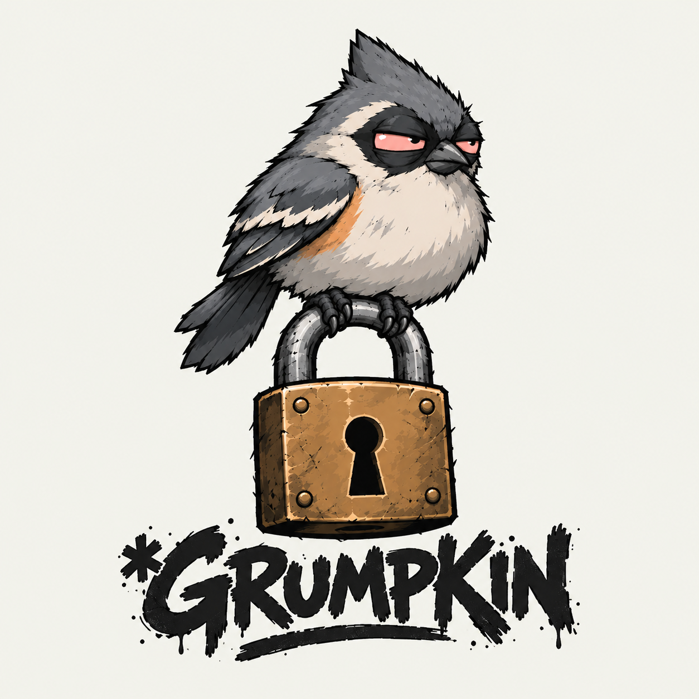

<div align="center">



# \*Grumpkin

**A password strength analyzer and sanitizer, written in Python.**

Scores how weak a password really is — the way an attacker sees it, not the way a "must contain one number" form sees it — and, when it's bad, hands back a genuinely strong replacement instead of a predictably-mutated one.

🚧 *In active development. Follow the build:* [@hrd_sec](https://twitter.com/hrd_sec)

</div>

---

## Why

Most password checkers are security theater. `P@ssw0rd1` passes nearly every "complexity rule" — uppercase, lowercase, number, symbol — and is cracked in seconds. Rule-counting measures the wrong thing.

Grumpkin measures the right thing: real-world guessability. It leans on pattern-based estimation (dictionary words, keyboard walks, `l33t` substitutions, dates, repeats) rather than counting character classes, and it checks whether a password has already appeared in a known breach — without the password ever leaving your machine.

## Design principles

These are deliberate decisions, not accidents:

- **Don't reinvent strength estimation.** Uses [`zxcvbn`](https://github.com/dropbox/zxcvbn) (Dropbox's estimator) for pattern-aware scoring, with an independent entropy calculation layered on top.
- **The sanitizer generates fresh — it never mutates.** Turning `password` into `Passw0rd!` produces a guessable result with false confidence. When a password is weak, Grumpkin generates a *new* cryptographically-random password or passphrase instead.
- **Cryptographically secure by default.** All generation uses Python's `secrets`, never `random`.
- **The password never leaves the machine.** Breach checks use the [Have I Been Pwned](https://haveibeenpwned.com/API/v3#PwnedPasswords) range API via **k-anonymity**: the password is SHA-1 hashed locally, only the first 5 hex characters of the hash are sent, and matching happens on your machine. HIBP never sees the password or its full hash.
- **Secure input.** Passwords are read with `getpass` — no terminal echo, no shell history.

## Planned features

- [ ] Strength scoring (`zxcvbn` + entropy) with crack-time estimate
- [ ] Breach check via HIBP k-anonymity
- [ ] Strong password / passphrase generator (`secrets`-based)
- [ ] CLI with secure input
- [ ] Test suite

## Project structure

```
grumpkin/
├── grumpkin/
│   ├── analyzer.py     # strength scoring + entropy
│   ├── generator.py    # secure password / passphrase generation
│   ├── breach.py       # HIBP k-anonymity check
│   └── cli.py          # command-line interface
├── tests/
└── requirements.txt
```

## Getting started

```bash
git clone git@github.com:H-R-Dept/Grumpkin.git
cd Grumpkin
python -m venv venv
source venv/bin/activate        # Windows: venv\Scripts\activate
pip install -r requirements.txt
```

*(CLI is not yet wired up — see Planned features.)*

## About

Grumpkin is a portfolio project built in public as part of a career pivot into security. Build notes and write-ups: [@hrd_sec](https://twitter.com/hrd_sec).

A [Hood Research Department](https://github.com/H-R-Dept) project.

## License

TBD — MIT planned.
